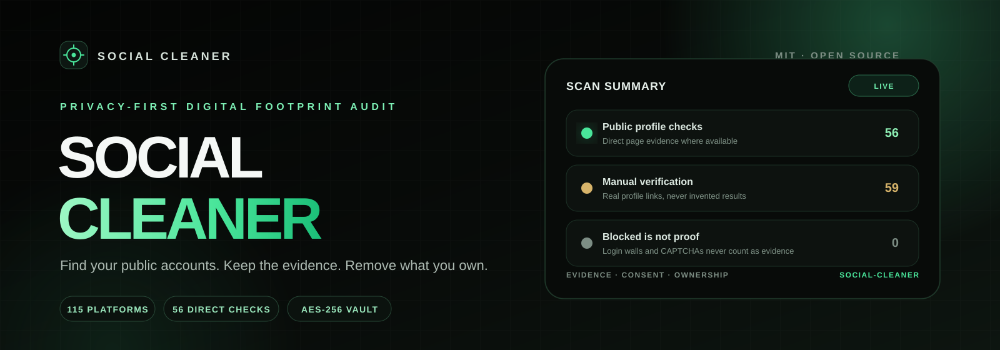
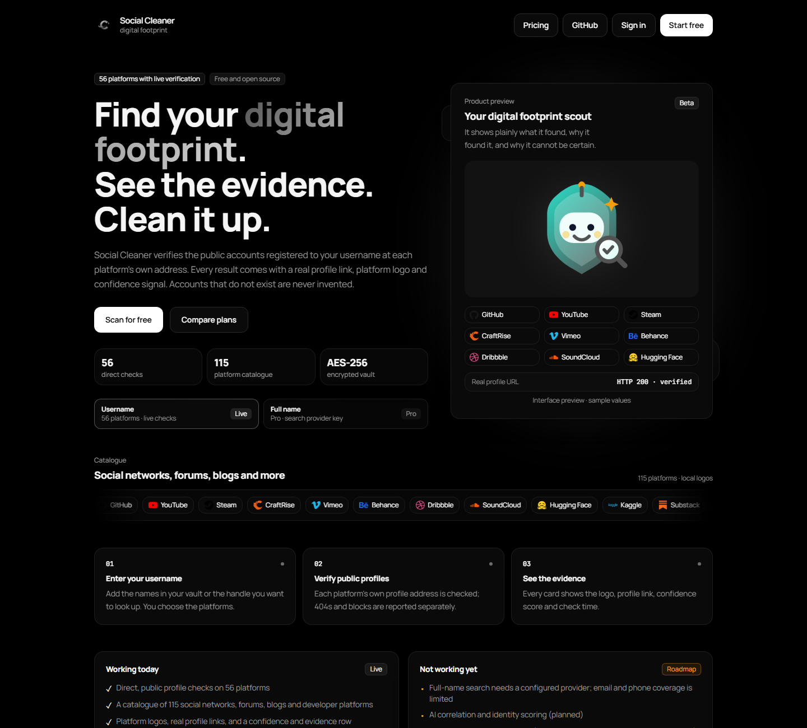
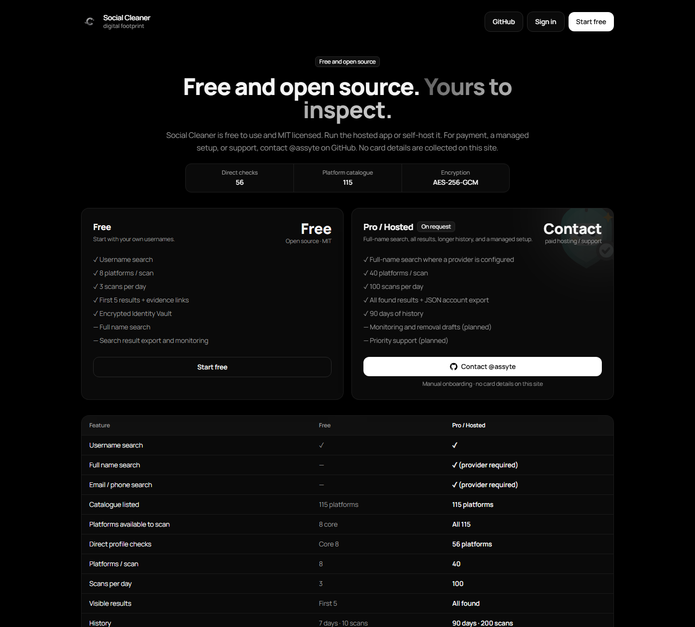
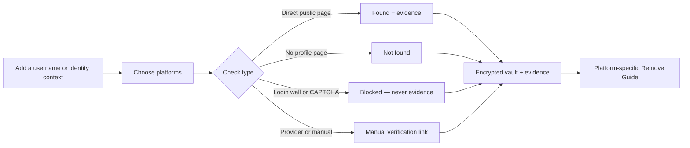

<p align="center">
  
</p>

<p align="center">
  <a href="https://github.com/assyte/social-cleaner/actions/workflows/ci.yml"></a>
  <a href="LICENSE"></a>
  
  
  
  
</p>

<p align="center">
  <strong>A privacy-first inventory of your public digital footprint.</strong><br>
  Find the accounts registered to your username, keep the evidence, and work through
  platform-specific removal steps — without a people-search database, ownership guessing,
  or invented results.
</p>

<p align="center">
  <a href="#product-preview">Preview</a> ·
  <a href="#how-it-works">How it works</a> ·
  <a href="#quick-start">Quick start</a> ·
  <a href="#security-model">Security</a> ·
  <a href="#plans">Plans</a> ·
  <a href="CHANGELOG.md">Changelog</a> ·
  <a href="https://github.com/assyte">Support</a>
</p>

> **Honesty note:** a username match is not proof of ownership. Login walls, CAPTCHAs,
> blocked pages, and stolen data are never treated as evidence. Social Cleaner does not claim
> that the whole internet was scanned, that every account was found, or that deletion is
> guaranteed.

## Status

| Track | Status |
| --- | --- |
| **Source** | Public on GitHub under the MIT License. CI, CodeQL, Dependabot, secret scanning, push protection, private vulnerability reporting, and `main` branch protection are enabled. |
| **Hosted app** | Pre-public-release. A hosted public launch is blocked on legal pages, transactional email, production infrastructure, monitoring, and a real search-provider key. |
| **Billing** | Free to use. Paid hosting/support is arranged manually through [@assyte on GitHub](https://github.com/assyte). There is no checkout and no card collection on the site. |

The repository is published as **free and open source** first. A hosted service can follow
after the operational and legal blockers in
[`docs/LAUNCH-READINESS.md`](docs/LAUNCH-READINESS.md) are closed.

## Product preview

<p align="center">
  
  
</p>

<p align="center">
  <sub>Local production build, 1440 px viewport. No real user data is shown.</sub>
</p>

## Why Social Cleaner

Most “find yourself online” tools blur three different things: a username match, a real
profile, and proof that the account belongs to you. Social Cleaner keeps them separate.

- **Evidence first.** Every result points to the public profile URL that was checked and
  records a readable evidence row. A `200` page, a `404`, a login wall, and a manual-only
  platform are different outcomes.
- **Blocked is not proof.** A CAPTCHA or login wall never becomes a “found” result and never
  becomes a “not found” result. It is recorded as blocked or unverified.
- **Ownership stays explicit.** The user declares ownership; the app does not infer it from a
  name, email, phone number, or profile picture.
- **Removal is guidance, not magic.** The Remove Guide explains platform-specific steps. It
  does not claim to delete accounts automatically or guarantee removal.
- **Privacy is the architecture.** Identity fields are encrypted in the vault, cookies are
  opaque, mutations are origin- and CSRF-checked, and the browser never receives another
  user's data.

## How it works



The scan surface is deliberately narrow: **115 catalogue platforms**, with **56** having
direct public-page checks. The rest are provider-backed or manual links, and the UI labels
that difference instead of implying universal automatic coverage.

## Coverage

| Metric | Value |
| --- | ---: |
| Catalogue platforms | **115** |
| Direct public-page checks | **56** |
| Free-plan core platforms | **8** |
| Search modes | Username on Free; name/email/phone on Pro where a provider is configured |
| Evidence states | found · not found · blocked · manual |
| Identity vault | AES-256-GCM fields + HMAC blind indexes |
| Account export | Schema v2 JSON, including vault, search history, evidence, and audit events |

The catalogue spans social networks, forums, blogs, developer platforms, video, gaming, music,
messaging, streaming, professional, education, commerce, photos, and reading sites. Platform
logos are local assets and belong to their respective owners; see
[`public/brand/platforms/NOTICE.md`](public/brand/platforms/NOTICE.md).

## Plans

| | Free | Pro / Hosted |
| --- | --- | --- |
| Search modes | Username | Username + full name + email/phone where a provider is configured |
| Catalogue access | 8 core platforms | All 115 catalogue platforms |
| Platforms per scan | 8 | 40 |
| Scans per day | 3 | 100 |
| Visible results | First 5 + evidence links | All found (max 40) |
| History | 7 days / 10 runs | 90 days / 200 runs |
| JSON account export | — | Yes |
| Monitoring and removal drafts | Planned | Planned |
| Price | Free | **Contact — manual only** |
| Checkout | None | None; no card collection |

Free/Pro limits are enforced on the server, not in the browser. Switching a local account
between plans is intentionally manual:

```bash
npm run plan:set -- user@example.com free
npm run plan:set -- user@example.com pro
```

Paid hosting, a managed setup, and support scope are discussed manually through
[GitHub @assyte](https://github.com/assyte). No public price is listed and no payment is
collected by this repository. Priority support is not sold until its terms are published.

## Quick start

Requires **Node.js 22.12+** (developed with Node 24) and npm.

```bash
git clone https://github.com/assyte/social-cleaner.git
cd social-cleaner
npm install
npm run setup        # creates .env.local with a random SC_MASTER_KEY
npm run db:migrate   # creates the local SQLite schema
npm run dev          # http://localhost:3000
```

`npm run setup` never overwrites an existing `.env.local`. If you lose `SC_MASTER_KEY`,
encrypted vault fields cannot be recovered. If you use a different port or host, set
`SC_APP_URL` to that exact origin; login and mutation requests fail closed when the origin
does not match.

### Environment

| Variable | Required | Purpose |
| --- | --- | --- |
| `SC_MASTER_KEY` | Yes | Base64-encoded 32 random bytes. Derives field-encryption and blind-index keys. |
| `SC_APP_URL` | Yes | Exact public origin, without a trailing slash. Used for origin checks. |
| `SC_DATABASE_URL` | No | SQLite/libSQL URL. Defaults to the local `data/app.db`. |
| `SC_SEARCH_PROVIDER` | No | `mock`, `free`, `brave`, or `tavily`. Defaults to `mock`. |
| `SC_SEARCH_API_KEY` | Provider-dependent | Key for Brave or Tavily. Not needed for `mock`/`free`. |
| `SC_AI_PROVIDER` | No | Reserved for a future AI module; not wired to user-facing features yet. |
| `SC_BREACH_PROVIDER` | No | Reserved for a future breach-notification module. |

With the default `mock` provider, name/email/phone searches return `503` instead of
fabricated results. The `free` provider covers GitHub and Gravatar only. Never commit
`.env.local`, `data/`, or a real key.

## Commands

| Command | Description |
| --- | --- |
| `npm run dev` | Development server on port 3000 |
| `npm run build` / `npm start` | Production build / production server |
| `npm run typecheck` | Strict TypeScript check |
| `npm test` | Vitest suite; isolated in-memory SQLite, no test DB files left on disk |
| `npm run verify` | typecheck + tests + production build |
| `npm run db:migrate` | Apply pending migrations (idempotent) |
| `npm run db:reset -- --yes` | Delete the local database — **all data is lost** |
| `npm run retention:sweep` | Delete expired sessions, old search runs/audit events, stuck runs |
| `npm run plan:set -- email free\|pro` | Manual plan switch; there is no checkout |

## Security model

| Layer | Implementation |
| --- | --- |
| Authentication | Own session layer: scrypt password hashes + opaque session tokens |
| Cookies | `HttpOnly`, `Secure` in production, `SameSite=Lax`; CSRF cookie is intentionally readable |
| Mutations | Same-origin check + double-submit CSRF token |
| Vault | AES-256-GCM field encryption + HMAC-SHA256 blind indexes |
| Plan enforcement | Server-side checks on every API route; hidden UI is never the boundary |
| Outbound checks | SSRF guard, URL allowlists, response-size cap, timeout and redirect limits |
| Rendering | Output encoding, nonce-based CSP, no third-party images or scripts |
| Operations | HMAC-hashed IP/UA audit fields, retention sweep, no ad tech or data sales |
| Account control | Password-confirmed deletion, schema v2 export, session invalidation |

Known limits are documented rather than hidden: rate limits are in-memory, scans are
synchronous, name/email/phone checks depend on an external provider, and the app should run
behind a trusted proxy that overwrites forwarding headers. See
[`docs/LAUNCH-READINESS.md`](docs/LAUNCH-READINESS.md) and [`SECURITY.md`](SECURITY.md).

> For security reports, use GitHub private vulnerability reporting or ask
> [@assyte](https://github.com/assyte) for a private channel. Do not open a public issue and do
> not test with real personal data.

## Verification

| Check | Result |
| --- | --- |
| `npm run verify` | Typecheck, **102/102 tests**, production build |
| `npm audit --audit-level=high` | **0 known vulnerabilities** |
| CI | GitHub Actions on `main`: typecheck, tests, build, and dependency audit |
| Security automation | CodeQL, Dependabot, secret scanning, push protection, and private vulnerability reporting |
| Public pages | `/`, `/pricing`, `/login`, `/register` return `200` |
| Auth boundary | Protected pages redirect to `/login`; protected APIs return `401` |
| CSRF/origin | Missing CSRF token and cross-origin mutation return `403` |
| Export | Schema v2 JSON with `Cache-Control: no-store` |
| Test isolation | In-memory SQLite; no `data/test-*.db` artifacts |
| Search default | `mock` returns `503` instead of fabricated name/email/phone results |

Production is intentionally `noindex` until launch. `/robots.txt` and `/sitemap.xml` are
deferred; the global `X-Robots-Tag: noindex, nofollow` header, CSP, HSTS, frame denial, and
referrer policy are already in place.

## Project structure

```text
src/app/               Next.js App Router pages and API routes
src/components/        AMOLED UI, search workspace, vault, Remove Guide
src/server/auth/       Sessions, cookies, CSRF/origin guards, rate limits
src/server/crypto/     Field encryption, blind indexes, password hashing
src/server/db/         Drizzle schema, migrations, SQLite client
src/server/search/     115-platform catalogue, direct checks, providers
src/server/removal/    Removal guidance and deletion data
src/server/vault/      Encrypted identity vault and ownership declarations
tests/                 API, security, crypto, search, and integrity tests
docs/                  Architecture, API, threat model, audits, launch plan
```

## Roadmap

| Phase | Focus |
| --- | --- |
| **Source release** | Complete: public repository, green CI, branch protection, CodeQL, secret scanning, Dependabot, private vulnerability reporting |
| **Hosted beta** | Legal pages, transactional email, production DB/backups, monitoring, provider key, trusted proxy |
| **Later** | Durable scan queue, Redis/DB rate limits, monitoring and removal drafts, AI/visual assistance, breach notifications |

The product deliberately does **not** ship empty claims for later features. Monitoring and
removal drafts are marked `Planned`; AI and breach modules are not wired to the UI.

## Contributing

Read [`CONTRIBUTING.md`](CONTRIBUTING.md) before opening a pull request. Participation is
covered by [`CODE_OF_CONDUCT.md`](CODE_OF_CONDUCT.md). Use synthetic data only; never commit
real identity data, cookies, database files, API keys, or `SC_MASTER_KEY`.

Security reports belong in [`SECURITY.md`](SECURITY.md), not in a public issue.

## License

MIT — see [`LICENSE`](LICENSE). Bundled fonts are licensed under the SIL Open Font License
1.1; see [`public/fonts/NOTICE.md`](public/fonts/NOTICE.md) and
[`public/fonts/OFL.txt`](public/fonts/OFL.txt). Platform names and logos belong to their
owners and are used only for identification; see
[`public/brand/platforms/NOTICE.md`](public/brand/platforms/NOTICE.md).

<p align="center">
  <a href="https://github.com/assyte"></a>
</p>

<p align="center">
  <sub>Built for people who want to clean up their own accounts, not search for someone else's.</sub>
</p>
